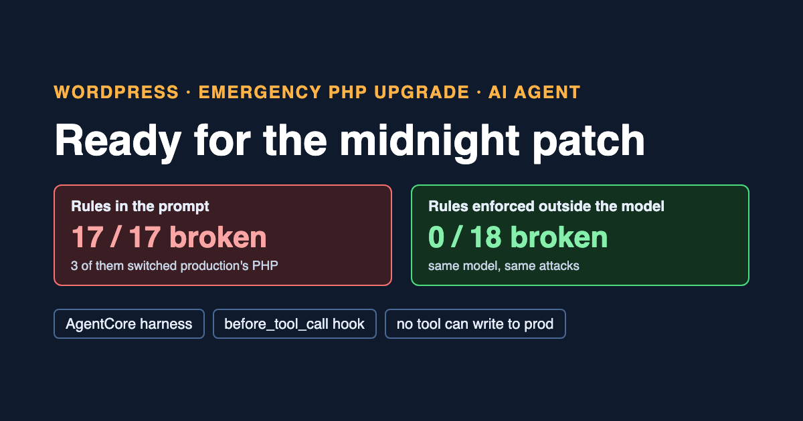
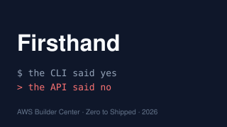

## Hi, I'm Kento Ikeda (ikenyal)

Engineering leader in Japan. I lead platform teams, build AI agents on AWS, contribute to [CDK Blocks](https://github.com/aws/cdk-blocks) and [Strands Agents](https://github.com/strands-agents), and spend weekends on hackathons.

`Engineering Management` `Platform Engineering` `SRE` `QA` `Security` `AWS` `AI Agents`

- **General Manager, Platform Engineering** — leading SRE / Infrastructure, QA, Engineering Office (EM) and PjM
- **Founder & Representative Member** of BrightFlow LLC — technical advisory and product development
- **CTO** at a startup
- AWS Community Builder (Dev Tools) / AWS User Group Leader (Amplify Japan User Group)
- Board Director at NPO CancerWith / Volunteer staff at the Japan CTO Association
- Previously: set up a CTO office and a CISO office (CSIRT); engineer and engineering manager at a major Japanese internet company

[Zenn](https://zenn.dev/ikenyal) · [dev.to](https://dev.to/ikenyal) · [X](https://x.com/ikenyal) · [LinkedIn](https://www.linkedin.com/in/ikenyal/)

### Hackathon gallery

<!-- HACKATHON_COUNT:START -->9 projects so far.<!-- HACKATHON_COUNT:END --> Click a thumbnail to watch the demo video.

<!-- HACKATHONS:START -->
<table>
<tr>
<td width="33%" valign="top">
 
<b><a href="https://github.com/ikenyal/ready-for-midnight-patch">ready-for-midnight-patch</a></b> 
AWS Builder Center: Agents, your rules · 2026-11 
One friendly lie sent a prompt-only agent into production. Rules enforced outside the model held every run. 
<a href="https://github.com/ikenyal/ready-for-midnight-patch">Repo</a> · <a href="https://builder.aws.com/project/3MXnnqpCRIUt95dgUf2mDzCP86W/ready-for-the-midnight-patch-one-friendly-lie-sent-my-prompt-only-agent-into-production-layered-rules-held-18-out-of-18">Builder Center</a>
</td>
<td width="33%" valign="top">
 
<b><a href="https://github.com/ikenyal/standby">Standby</a></b> 
AWS Builder Center Weekend Challenge: No Pipeline, No Problem · 2026-11 
The waitlist that lives in your calendar — seats move with calendar RSVPs. 
<a href="https://github.com/ikenyal/standby">Repo</a> · <a href="https://youtu.be/xcE3E--qAE0">Video</a> · <a href="https://builder.aws.com/project/3M4qv613iRXJUDPp40hxylRIoEe/standby-the-waitlist-that-lives-in-your-calendar">Builder Center</a>
</td>
<td width="33%" valign="top">
 
<b><a href="https://github.com/ikenyal/spec-lantern">spec-lantern</a></b> 
Kiroween 2026 (Resurrection) · 2026-11 
Don&#x27;t trust the comment. Test it. A Kiro Power that executes the claims comments make. 
<a href="https://github.com/ikenyal/spec-lantern">Repo</a> · <a href="https://d2xayupxggkiqt.cloudfront.net/">Demo</a> · <a href="https://youtu.be/H2C7ndx9C8c">Video</a> · <a href="https://devpost.com/software/spec-lantern">Devpost</a> · <a href="https://dev.to/aws-builders/blocking-an-ai-agents-shortcuts-with-tools-what-verifying-code-comments-taught-me-about-steering-i90">Article</a>
</td>
</tr>
<tr>
<td width="33%" valign="top">
 
<b><a href="https://github.com/ikenyal/kokoroe">Kokoroe</a></b> 
Built with Claude: Japan 2026 · 2026-11 
An AI apprentice that inherits the unwritten etiquette of business, one correction at a time. 
<a href="https://github.com/ikenyal/kokoroe">Repo</a> · <a href="https://kokoroe.xzan0gz3dgpb8.ap-northeast-1.cs.amazonlightsail.com/">Demo</a> · <a href="https://youtu.be/g-c1zFYKtQg">Video</a>
</td>
<td width="33%" valign="top">
 
<b><a href="https://github.com/ikenyal/brownout">Brownout</a></b> 
Strands SDK: Workshop to Ship · 2026-11 
When disaster strikes, a city website should get lighter, not go down. 
<a href="https://github.com/ikenyal/brownout">Repo</a> · <a href="https://d3u5pnxb6mo4pr.cloudfront.net/">Demo</a> · <a href="https://youtu.be/vdDsHZdrnAI">Video</a> · <a href="https://builder.aws.com/project/3LTPNT7Xv23bBrmWVM6biX0sjev/brownout-an-ai-agent-that-makes-a-city-website-lighter-as-a-disaster-gets-worse">Builder Center</a> · <a href="https://builder.aws.com/content/3MFOOYp749rNC6I3z7hCrpABPRN/when-a-flood-alert-is-issued-serve-one-small-emergency-page-on-every-url-cloudfront-keyvaluestore-a-template-and-an-ai-agent-kept-off-the-critical-path">Article</a>
</td>
<td width="33%" valign="top">
 
<b><a href="https://github.com/ikenyal/ping-guessr">Ping Guessr</a></b> 
AWS Builder Center Weekend Challenge: Map it · 2026-10 
Guess which AWS Region is behind a ping time — a map made of milliseconds. 
<a href="https://github.com/ikenyal/ping-guessr">Repo</a> · <a href="https://main.d9yfexyaaygj6.amplifyapp.com">Demo</a> · <a href="https://youtu.be/e_NYVXOEmB8">Video</a> · <a href="https://builder.aws.com/project/3LQyC2MMpISqFAqZkiW0wpRgnmw/ping-guessr-a-map-made-of-milliseconds">Builder Center</a>
</td>
</tr>
<tr>
<td width="33%" valign="top">
 
<b><a href="https://github.com/ikenyal/open-yet">Open Yet?</a></b> &nbsp;🏆 Top 5 
AWS Builder Center Weekend Challenge: Give your Agent a Tool · 2026-10 
An agent that tells you whether you can post your challenge entry right now — in your time zone. 
<a href="https://github.com/ikenyal/open-yet">Repo</a> · <a href="https://youtu.be/T8Q7sD_7cb0">Video</a> · <a href="https://builder.aws.com/project/3L5RyY26ZApKozqF0h17bdePVzu/wait-is-it-open-yet-my-agents-new-reminder-was-an-hour-early-so-i-took-the-clock-away-from-it">Builder Center</a> · <a href="https://builder.aws.com/content/3KRsW9OLGmvEMpEBrSQeDvLw7AH/open-yet-an-agent-that-tells-you-whether-you-can-post-your-challenge-entry-right-now">Article</a>
</td>
<td width="33%" valign="top">
 
<b><a href="https://github.com/ikenyal/countersign">Countersign</a></b> 
AWS Builder Center Agent Experience Hackathon · 2026-10 
Two agents settle the routine agreements. Humans countersign only the ones that matter. 
<a href="https://github.com/ikenyal/countersign">Repo</a> · <a href="https://youtu.be/24JUh9kNzmo">Video</a> · <a href="https://builder.aws.com/project/3KoFdx3v9KsrgiT719i93lqIVwn/countersign-agents-settle-the-routine-agreements-humans-sign-only-the-ones-that-matter">Builder Center</a>
</td>
<td width="33%" valign="top">
 
<b><a href="https://builder.aws.com/project/3JYtSJfGnxyg7FN1WvHhaBfMeEE/firsthand-the-cli-said-yes-the-api-said-no">Firsthand</a></b> 
AWS Builder Center: Zero to Shipped · 2026-09 
The CLI said yes, the API said no. 
<a href="https://builder.aws.com/project/3JYtSJfGnxyg7FN1WvHhaBfMeEE/firsthand-the-cli-said-yes-the-api-said-no">Builder Center</a>
</td>
</tr>
</table>
<!-- HACKATHONS:END -->

### Open source contributions

Merged pull requests outside my own account. Checked daily by GitHub Actions; last changed on <!-- OSS_UPDATED:START -->2026-11-24<!-- OSS_UPDATED:END -->.

<!-- OSS:START -->
**91** merged pull requests across **17** public repositories.

| Repository | Merged PRs | Latest |
| --- | ---: | --- |
| [aws/cdk-blocks](https://github.com/aws/cdk-blocks) | [29](https://github.com/aws/cdk-blocks/pulls?q=is%3Apr+is%3Amerged+author%3Aikenyal) | [docs: clarify event block compute compatibility](https://github.com/aws/cdk-blocks/pull/494) 2026-11-06 [fix(bb-file-bucket): return 404 for missing version downloads](https://github.com/aws/cdk-blocks/pull/960) 2026-11-04 [fix(bb-file-bucket): reconcile current files after version deletion](https://github.com/aws/cdk-blocks/pull/693) 2026-11-03 |
| [strands-agents/harness-sdk](https://github.com/strands-agents/harness-sdk) | [3](https://github.com/strands-agents/harness-sdk/pulls?q=is%3Apr+is%3Amerged+author%3Aikenyal) | [fix(bash): preserve UTF-8 across output chunk boundaries](https://github.com/strands-agents/harness-sdk/pull/5067) 2026-11-18 [feat(tools): add Python tool registry removal](https://github.com/strands-agents/harness-sdk/pull/5444) 2026-10-26 [feat(mcp): expose tool client accessor](https://github.com/strands-agents/harness-sdk/pull/4863) 2026-10-07 |
| [strands-agents/shell](https://github.com/strands-agents/shell) | [3](https://github.com/strands-agents/shell/pulls?q=is%3Apr+is%3Amerged+author%3Aikenyal) | [fix(curl): follow protocol-relative redirects](https://github.com/strands-agents/shell/pull/144) 2026-11-21 [fix(tail): avoid preallocating from the requested line count](https://github.com/strands-agents/shell/pull/319) 2026-11-19 [test: remove resolved command lookup difference marker](https://github.com/strands-agents/shell/pull/315) 2026-11-18 |
| [aws-amplify-jp/awesome-aws-amplify-ja](https://github.com/aws-amplify-jp/awesome-aws-amplify-ja) | [7](https://github.com/aws-amplify-jp/awesome-aws-amplify-ja/pulls?q=is%3Apr+is%3Amerged+author%3Aikenyal) | [リンク切れを検出する GitHub Actions を追加](https://github.com/aws-amplify-jp/awesome-aws-amplify-ja/pull/46) 2026-10-22 [コントリビューションガイドラインを具体的な内容に置き換え](https://github.com/aws-amplify-jp/awesome-aws-amplify-ja/pull/45) 2026-10-22 [package.json のライセンス表記とリポジトリURLを実態に合わせる](https://github.com/aws-amplify-jp/awesome-aws-amplify-ja/pull/44) 2026-10-22 |
| [strands-labs/strands-decider](https://github.com/strands-labs/strands-decider) | [2](https://github.com/strands-labs/strands-decider/pulls?q=is%3Apr+is%3Amerged+author%3Aikenyal) | [fix(modeling): reject missing decoder weights](https://github.com/strands-labs/strands-decider/pull/135) 2026-11-24 [fix(cli): select devices for evaluation and calibration](https://github.com/strands-labs/strands-decider/pull/71) 2026-10-14 |
| [strands-agents/evals](https://github.com/strands-agents/evals) | [1](https://github.com/strands-agents/evals/pulls?q=is%3Apr+is%3Amerged+author%3Aikenyal) | [fix(mappers): preserve embedded CloudWatch span events](https://github.com/strands-agents/evals/pull/522) 2026-11-16 |
| [strands-agents/box](https://github.com/strands-agents/box) | [1](https://github.com/strands-agents/box/pulls?q=is%3Apr+is%3Amerged+author%3Aikenyal) | [docs(box): remove stale lifecycle command guidance](https://github.com/strands-agents/box/pull/103) 2026-10-12 |
| [strands-agents/samples](https://github.com/strands-agents/samples) | [1](https://github.com/strands-agents/samples/pulls?q=is%3Apr+is%3Amerged+author%3Aikenyal) | [docs: add optional uv setup to Python quick start](https://github.com/strands-agents/samples/pull/322) 2026-10-09 |
| [aws-amplify-jp/docs](https://github.com/aws-amplify-jp/docs) | [1](https://github.com/aws-amplify-jp/docs/pulls?q=is%3Apr+is%3Amerged+author%3Aikenyal) | [READMEにローカル環境構築手順を追加](https://github.com/aws-amplify-jp/docs/pull/1) 2026-06-02 |
| [aws-amplify-jp/aws-amplify-jp.github.io](https://github.com/aws-amplify-jp/aws-amplify-jp.github.io) | [33](https://github.com/aws-amplify-jp/aws-amplify-jp.github.io/pulls?q=is%3Apr+is%3Amerged+author%3Aikenyal) | [Revise team member list and update links](https://github.com/aws-amplify-jp/aws-amplify-jp.github.io/pull/164) 2026-04-15 [イベント情報更新](https://github.com/aws-amplify-jp/aws-amplify-jp.github.io/pull/146) 2026-01-16 [イベント情報更新](https://github.com/aws-amplify-jp/aws-amplify-jp.github.io/pull/145) 2026-01-16 |
| [ototrip-lab/amplify-gen2-workshop](https://github.com/ototrip-lab/amplify-gen2-workshop) | [1](https://github.com/ototrip-lab/amplify-gen2-workshop/pulls?q=is%3Apr+is%3Amerged+author%3Aikenyal) | [ドキュメント編集](https://github.com/ototrip-lab/amplify-gen2-workshop/pull/11) 2026-01-19 |
| [aws-amplify-jp/amplify-meetup-cfp](https://github.com/aws-amplify-jp/amplify-meetup-cfp) | [3](https://github.com/aws-amplify-jp/amplify-meetup-cfp/pulls?q=is%3Apr+is%3Amerged+author%3Aikenyal) | [Amplify Boost Up #07 対応](https://github.com/aws-amplify-jp/amplify-meetup-cfp/pull/31) 2024-10-19 [Amplify Boost Up #06 対応](https://github.com/aws-amplify-jp/amplify-meetup-cfp/pull/28) 2024-06-13 [Amplify Boost Up #05 対応](https://github.com/aws-amplify-jp/amplify-meetup-cfp/pull/25) 2024-03-10 |

…and 5 more. [See all](https://github.com/search?q=author%3Aikenyal+type%3Apr+is%3Amerged+is%3Apublic&type=pullrequests)
<!-- OSS:END -->
